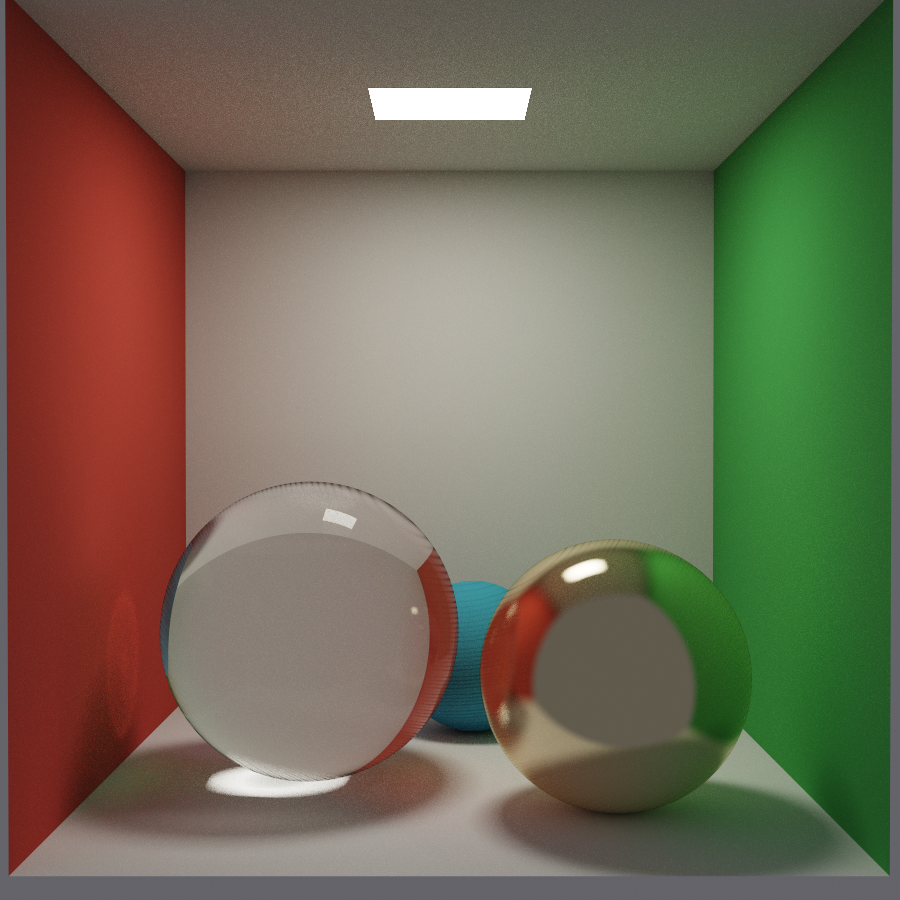
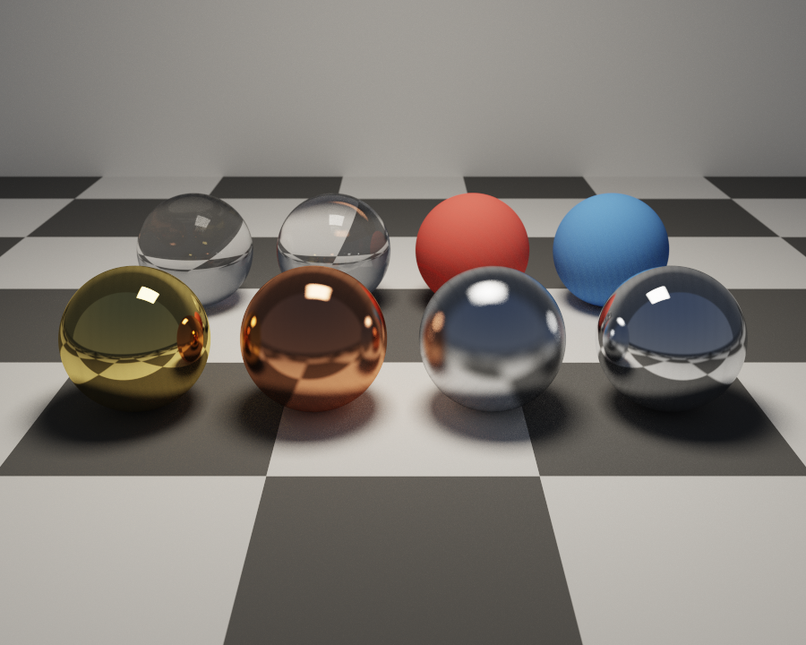
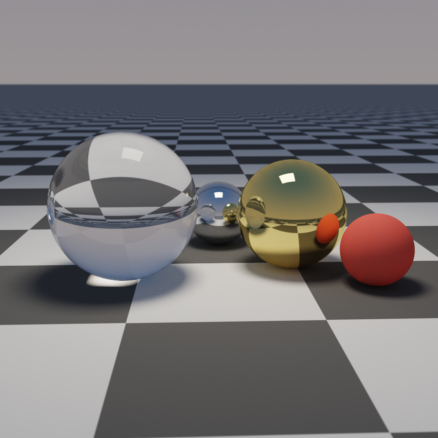
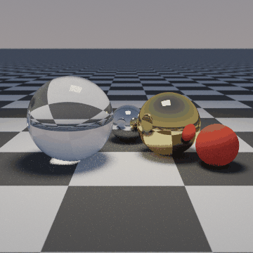

# pt — a path tracer in one C file

A small CPU path tracer written from scratch in a single ~840-line C file. No
dependencies beyond libc, pthreads and libm. It renders directly to PNG with a
hand-rolled encoder, so the whole thing builds with one `gcc` invocation.



## Build and run

```sh
make                      # or: gcc -O3 -march=native -ffast-math -o pt pt.c -lpthread -lm
./pt -o cornell.png                       # default scene, 700x700, 200 spp
./pt --scene open   --width 900 --height 900 --spp 1200 -o studio.png
./pt --scene materials --width 900 --height 720 --spp 1600 -o materials.png
```

Options: `--scene {cornell,open,materials,furnace}`, `-o FILE`, `--width`,
`--height`, `--spp`, `--depth`, `--threads`, `--exposure`, `--stats`,
`--angle DEG` (turntable frame for the `open` scene).




The `open` scene driven by `--angle` produces the turntable animation:



## What is implemented

- **Geometry:** spheres and triangles. Quads are two triangles; the Cornell box
  walls, the area light and the studio floor are all quads.
- **Materials:** Lambertian diffuse, fuzzy metal, smooth dielectric (Schlick
  Fresnel + Snell refraction), and emissive. A procedural checker pattern is
  available on diffuse materials.
- **Integrator:** unidirectional path tracing with next-event estimation (NEE)
  against a single rectangular area light. Emission is added only when the
  path has seen specular bounces (or on the primary ray), which is the standard
  way to avoid double counting with NEE.
- **Sampling:** cosine-weighted hemisphere sampling, PCG32 RNG seeded per
  `(pixel, sample)`, Russian roulette after three bounces.
- **Camera:** pinhole with optional thin-lens depth of field.
- **Imaging:** ACES filmic tone mapping, gamma 2.2, 8-bit PNG output with an
  uncompressed-deflate zlib stream.
- **Parallelism:** one pthread worker per core pulling rows from an atomic
  counter, so the workload stays balanced regardless of the scene.

## Verification

`make check` (or `./pt --scene furnace --spp 4000 --depth 20 --stats`) renders a
white diffuse sphere, a perfect mirror and a clear glass sphere in a uniform
environment of radiance 1. Energy conservation means the result must be flat
1.0. On this build:

```
mean radiance: 1.00000 1.00000 1.00000  (std 0.00009)
```

That exercises the BSDFs, Russian roulette and environment sampling together:
any missing factor in the diffuse or dielectric lobes, or a wrong roulette
weight, shows up immediately as a mean away from 1.

## Notes on performance

Timings on 12 cores at `-O3 -march=native -ffast-math`. The renderer reports
CPU-seconds summed across threads; the wall column is measured externally.

| scene      | resolution | spp  | CPU time | wall time |
|------------|-----------:|-----:|---------:|----------:|
| cornell    | 900 x 900  | 1600 | 1037 s   | ~87 s     |
| open       | 900 x 900  | 1200 | 199 s    | ~17 s     |
| materials  | 900 x 720  | 1600 | 432 s    | ~36 s     |
| turntable  | 360 x 360  | 128  | ~3 s     | ~0.3 s/frame |

The open scene is about four times faster per sample than the Cornell box: its paths
escape to the sky after one or two bounces instead of rattling around a closed
box until Russian roulette kills them.

Three non-obvious details that cost real debugging time:

1. **Checker lookup must round to cell centres.** A floor lying exactly on
   `y = 0` produces hit points with `y = ±1e-7`. `floorf(y / scale)` then
   returns `-1` or `0` depending on the sign of the epsilon, so half the
   samples picked the dark tile and half the light one. The pattern dissolved
   into flat noise as spp grew. Rounding (`floorf(p/scale + 0.5)`) moves the
   cell boundary away from zero and fixes it.
2. **Shadow rays must use the entry root only.** `occluded()` originally fell
   back to `-b + sqrt(b*b - c)` when the entry root was negative, to handle
   rays starting inside a sphere. For a shadow ray starting just outside a
   surface and pointing away, that expression subtracts two nearly equal
   numbers (~800 - ~800); the rounding error sometimes flipped it just above
   zero and the sphere shadowed itself. On a large diffuse sphere this showed
   up as a stable diagonal weave that did not average away with more samples.
   Restricting the test to the entry root removes the cancellation entirely.
3. **Caustic paths are fireflies.** A specular chain that finds the area light
   contributes its full radiance and is rare. Indirect contributions are
   clamped at 8.0 to keep the image readable; this is a deliberate small bias,
   noted in the code where it happens.

## Limitations

- One area light, no MIS, no importance sampling of the environment.
- No BVH: fine for a dozen primitives, quadratic for real scenes.
- Fixed 8-bit output, box filter, no denoiser.
- The PNG writer emits stored (uncompressed) deflate blocks, about 3 bytes per
  pixel. Linking zlib would shrink the files by an order of magnitude.
- The Cornell box is open toward the camera, so the metal sphere reflects a
  dark void. That is physically correct for an open box, not a bug.
